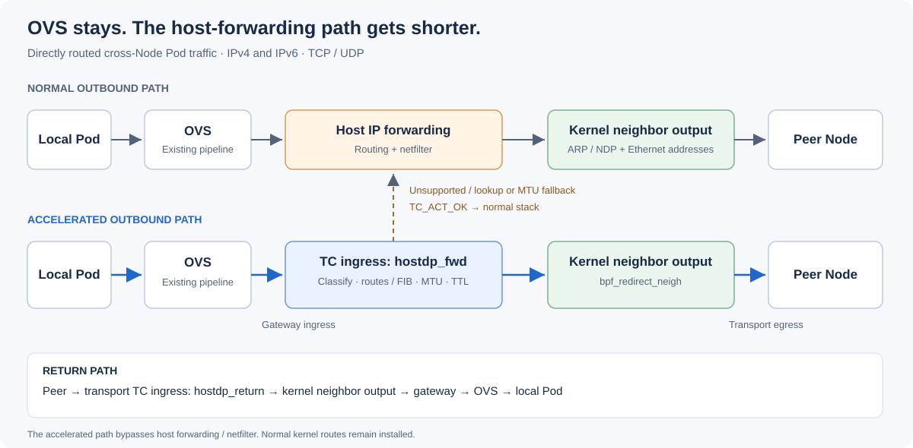
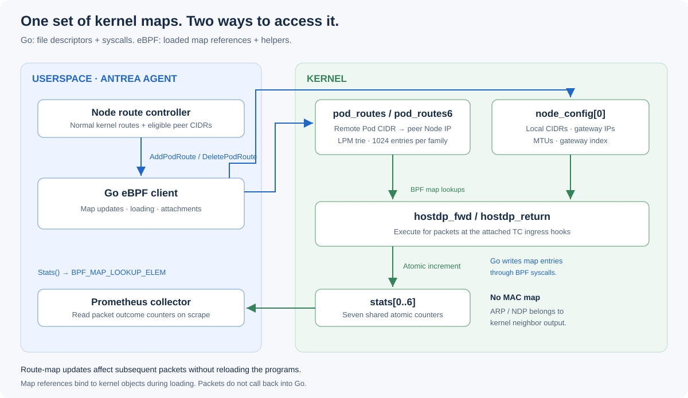
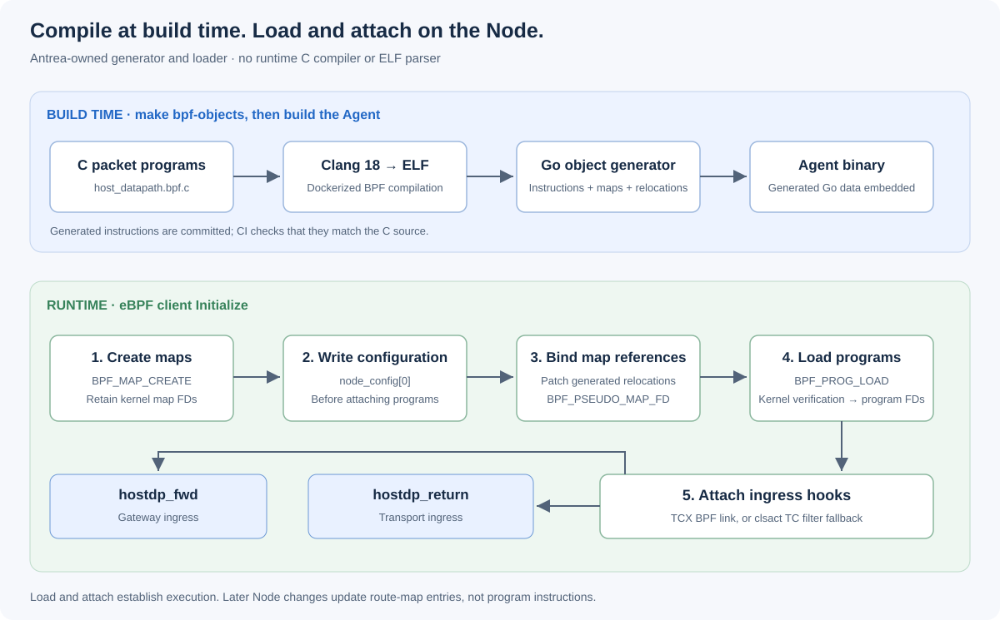

# Antrea eBPF Host Forwarding Framework

Design and prototype results for technical and management discussion. Updated 2026-11-16.
Implementation reference: `work/antrea-ebpf-c-learning`, commit `e39483eb1`.

## Executive overview

This prototype accelerates the Linux host-forwarding portion of directly routed cross-Node
Pod traffic. OVS continues to provide Pod networking and its existing policy and Service
processing. Two small eBPF programs shorten the path between the Antrea gateway and the
Node's transport interface, while reusing kernel routing and neighbor output.

Initial dual-stack Netperf results show approximately **21% higher TCP streaming throughput**
than the unaccelerated baseline. Connection-per-request results show a larger improvement:
approximately **40% for IPv4 and 153% for IPv6** in the reported environment. Compared with
the nftables acceleration configuration, eBPF was faster for connection-per-request,
slightly slower for streaming, and reported as broadly comparable for request/response.

These are prototype measurements from a Kind cluster on a MacBook Pro, not production
capacity claims. The framework is Alpha and disabled by default. The next step is to
validate its value and operational behavior on representative Linux deployments.

The implementation intentionally stays narrow: no eBPF NAT, no eBPF conntrack, no
five-tuple flow cache, and no Agent-managed IP-to-MAC discovery. It uses an Antrea-owned
build-time generator and runtime loader, without introducing a third-party eBPF loader.

## 1. What changes in the packet path



*Figure 1. OVS stays in the path. Eligible traffic takes a shorter host-forwarding path;
unsupported packets continue through the normal stack.*

Normally, OVS sends a remote-Pod packet through `antrea-gw0`. Linux then forwards it using
the routes installed by Antrea and processes the applicable host netfilter hooks.
The eBPF path runs at TC ingress, before that host IP-forwarding path:

| Direction | Attachment | Action |
| --- | --- | --- |
| Outbound | Gateway ingress, `hostdp_fwd` | Forward local-Pod traffic toward a directly routed peer Node |
| Inbound | Transport ingress, `hostdp_return` | Deliver remote-Pod traffic through the gateway to OVS |

For an eligible packet, the program:

1. Checks the IP family, protocol, and local/remote Pod address ranges.
2. Selects the peer Node from the Pod-CIDR route map, or the local Pod destination on return.
3. Uses `bpf_fib_lookup` to obtain the output interface and actual next hop.
4. Checks MTU suitability, including segment sizes of GRO aggregates when necessary.
5. Decrements TTL or Hop Limit, updating the IPv4 header checksum where required.
6. Calls `bpf_redirect_neigh`; kernel neighbor output handles Ethernet addressing and transmission.

The program still performs routing work on each packet. The saving comes from avoiding
the normal host IP-forwarding and netfilter path, not from eliminating route lookup.

Both directions have acceleration programs. Path selection is nevertheless per packet;
the framework does not promise connection-level path pinning.

### Scope of the prototype

| Area | Current scope |
| --- | --- |
| Platform | Linux Kubernetes Nodes |
| Enablement | `EBPFHostDataPath` feature gate; Alpha, default off |
| Address families | IPv4, IPv6, and dual stack |
| Protocols | TCP and UDP |
| Peer selection | Direct-routing predicate used by the Node route controller |
| noEncap | Peers matching that predicate; this is not all possible routed underlays |
| hybrid | Directly routed peers; tunneled peers retain their existing path |
| Local networking | Existing OVS pipeline retained |
| Explicit non-goals | NAT, conntrack, tunnel processing, and per-flow routing caches in eBPF |

## 2. How the Agent and programs share state



*Figure 2. Go updates kernel maps; packet programs read those same maps and update counters.
There is no per-packet callback into the Agent.*

The Node route controller retains the normal kernel routes and mirrors eligible remote
Pod CIDRs into the eBPF client. Each address family has its own longest-prefix-match map.
Changing a route updates a map entry; it does not reload or reattach the programs.

| Kernel map | Content | Agent access | Packet-program access |
| --- | --- | --- | --- |
| `pod_routes` | IPv4 Pod CIDR to peer Node IPv4 address | Add/delete CIDR entries | Longest-prefix lookup |
| `pod_routes6` | IPv6 Pod CIDR to peer Node IPv6 address | Add/delete CIDR entries | Longest-prefix lookup |
| `node_config` | Local CIDRs, gateway addresses, interface MTUs and gateway index | Write at initialization | Read configuration |
| `stats` | Seven packet-outcome counters | Read for Prometheus scrapes | Atomic counter increments |

These maps live in the kernel. The Go client accesses them through file descriptors and
`BPF_MAP_*` syscalls; eBPF accesses them through `bpf_map_lookup_elem` and map references
bound when the program is loaded. C and Go key/value layouts must agree on sizes,
padding, and byte order. Each route map currently supports 1024 CIDR entries.

For example, a Node event writes:

```text
pod_routes: 10.20.0.0/24 -> 192.168.1.12

Packet destination 10.20.0.8
    -> longest-prefix match selects Node 192.168.1.12
    -> kernel route lookup selects output interface and actual next hop
    -> kernel neighbor output resolves Ethernet addresses and sends the packet
```

The Pod-CIDR map is routing/classification state, not a flow cache or MAC cache.
Normal kernel routes and BPF maps are updated separately, so partial failure and
convergence must be handled explicitly.

## 3. How eBPF is built, loaded, and attached



*Figure 3. C is compiled at build time. At runtime the Agent creates maps, binds map
references, loads the programs for kernel verification, and attaches the ingress hooks.*

At build time, `make bpf-objects` compiles the C source with clang 18 in Docker.
`hack/gen-bpf-objects` extracts instructions, custom map metadata, and relocation records
from the ELF object into generated Go source. The Agent binary includes those generated
instructions; a Node needs neither a C compiler nor a runtime ELF parser.

At runtime, initialization performs four steps:

1. Create the kernel maps and retain their file descriptors.
2. Write Node configuration before attaching either program.
3. Patch generated map references with map FDs, then load each program with `BPF_PROG_LOAD`.
   The kernel verifies the instructions and map accesses.
4. Attach `hostdp_fwd` and `hostdp_return` to their respective ingress hooks.

The loader tries TCX BPF links first and falls back to clsact TC filters where unsupported.
The client checks attachments every 30 seconds and restores missing attachments on their
original interfaces. Interface replacement or MTU changes currently require an Agent restart.

The loader is deliberately constrained: map metadata uses a project-owned format and C
helpers are inlined. It does not implement a general CO-RE/BTF relocation system.
CI regenerates BPF objects to detect drift between C source and committed instructions.

## 4. Kernel-owned Layer 2 resolution

The framework separates three questions:

| Question | Owner |
| --- | --- |
| Which Node hosts this remote Pod CIDR? | Antrea route controller and BPF route maps |
| Which interface and next hop reach that address? | Kernel route lookup |
| What are the Ethernet addresses, and is the neighbor still reachable? | Kernel neighbor output |

`bpf_fib_lookup` uses `DIRECT | SKIP_NEIGH`: select the route without resolving MACs.
`bpf_redirect_neigh` then uses the selected next hop through the kernel ARP/NDP subsystem.
Missing neighbors can be resolved and packets queued; stale mappings can be revalidated
as traffic uses them. This reuses neighbor output without re-entering the full host
IP-forwarding and netfilter path.

Consequently, the eBPF client does not maintain a MAC map, register managed neighbors,
subscribe to CNI Pod updates, or keep per-Pod neighbor ownership records. Idle neighbors
follow the ordinary kernel lifecycle. The shared Agent Pod-update channel remains available
to other Antrea components.

In isolated x86_64 Linux namespace tests after this cleanup, both IP families passed cold
neighbor TCP forwarding and recovery after real peer-Node and local-Pod MAC changes.
Forward and return redirect counters increased with zero lookup/rewrite miss counts.
No managed-neighbor registration was present. This validates those cases on the tested
kernel; it does not replace testing across supported distributions and kernels.

## 5. Prototype performance results

The following results were supplied by the earlier benchmark session: noEncap, two Kind
Nodes on a MacBook Pro, one client, cross-Node Pod traffic, and Netperf default parameters.
The eBPF variant has no flow cache. Baseline, nftables acceleration, and eBPF were compared
within that reported environment.

| Test | Family | Baseline | nftables acceleration | eBPF, no flow cache | Change vs baseline |
| --- | --- | --- | --- | --- | --- |
| TCP_STREAM | IPv4 | 16.76 Gbps | 21.82 Gbps | 20.34 Gbps | +21.4% |
| TCP_STREAM | IPv6 | 16.28 Gbps | 20.75 Gbps | 19.70 Gbps | +21.0% |
| TCP_RR | IPv4 | 20.42 kTPS | Comparable; exact value not supplied | 24.15 kTPS | +18.3% |
| TCP_RR | IPv6 | 21.28 kTPS | Comparable; exact value not supplied | 23.69 kTPS | +11.3% |
| TCP_CRR | IPv4 | 8.05 kTPS | 6.57 kTPS | 11.24 kTPS | +39.6% |
| TCP_CRR | IPv6 | 4.34 kTPS | 4.80 kTPS | 10.99 kTPS | +153.2% |

TCP_STREAM measures bulk throughput. TCP_RR measures request/response transactions on an
established connection. TCP_CRR includes connection establishment for each transaction.
Percentages above are calculated from the displayed, rounded values; kTPS means thousands
of transactions per second.

The strongest signal is in connection-per-request workloads. The prototype does not show
a universal win over nftables: streaming is lower in both families, while request/response
was reported as broadly comparable. These results support further evaluation, not replacing
the existing acceleration option by default.

The earlier flow-cache experiment did not demonstrate enough benefit to justify its state
and invalidation complexity, so the current design performs routing decisions per packet.

### Evidence boundaries

- The benchmark predates the managed-neighbor cleanup in `e39483eb1`; performance has not
  been rerun for that commit. The later x86_64 namespace tests are correctness checks only.
- Raw run logs, repeat counts, variance, and complete host/VM resource settings were not
  included in the benchmark handoff. The table is a reported summary, not a new measurement.
- Do not combine these numbers with the AWS/Kind results in the existing
  [nftables acceleration design](traffic-acceleration.md); those use a different environment.
- Follow-up measurements should include representative Linux Nodes, CPU usage, latency,
  packet sizes, concurrency, and connection churn, with repeated runs and variability.

## 6. Compatibility and failure boundaries

The current prototype does not support NodePortLocal or hostPort flows that require host
reverse NAT while preserving a directly routed remote Pod source. These remain explicit
scope limitations; this framework does not add connection tracking to accommodate them.

Accelerated packets bypass host netfilter forwarding hooks. Deployments relying on those
hooks need an explicit compatibility decision. The current `DIRECT` lookup also bypasses
policy-rule routing; general policy-routing/VRF support is not established.

Unsupported protocols and formats, route misses, exhausted TTL/Hop Limit, and packets
requiring kernel MTU handling normally return `TC_ACT_OK` to continue through the original
stack. GRO aggregate length alone is not treated as an MTU violation: segment-aware checks
are used when needed. This is a fallback mechanism, not a guarantee of delivery; redirect
and later neighbor-output failures can still drop packets.

Initialization failure is logged and the Agent continues without the acceleration client.
Prometheus exports `antrea_agent_ebpf_packets_total` with seven outcomes. Redirect counters
record attempts, not confirmed peer delivery.

Two concrete lifecycle issues remain to be addressed:

1. Isolate BPF route-map update failures from normal Node route reconciliation, retaining
   enough state to clean up partial installations and preventing stale acceleration entries.
2. Clean up legacy TC filters left by an Agent crash when the feature is subsequently
   disabled. Closing a TCX link and removing a persistent TC filter have different lifetimes.

## 7. Proposed next milestone

Keep the packet-processing scope narrow and the loader Antrea-owned. Complete the failure
isolation and crash/disable cleanup above, then add repeatable packet-level regression
coverage and reproduce the benchmark on representative Linux infrastructure.

The review decisions are the supported deployment contract, acceptable recovery behavior,
required operational visibility, and the workload benefit that justifies maintaining this
acceleration path. NodePortLocal support, eBPF NAT/conntrack, and a third-party loader are
outside the current milestone.

## Implementation references

- [C packet programs](../../pkg/agent/ebpf/bpf/host_datapath.bpf.c)
- [Go client and map updates](../../pkg/agent/ebpf/client_linux.go)
- [BPF syscall and attachment layer](../../pkg/agent/ebpf/internal/bpf/)
- [Build-time object generator](../../hack/gen-bpf-objects/)
- [Operational design and counters](ebpf-host-datapath.md)
- [Existing nftables acceleration](traffic-acceleration.md)
